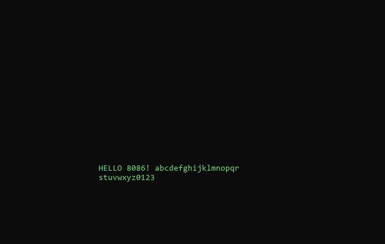
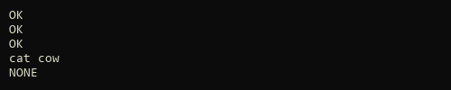

# assembly-notebook

[](https://github.com/jioshiyu/assembly-notebook/actions/workflows/ci.yml)

8086 汇编课程作业整理：把散落在桌面的 8 个实验、21 个 `.asm` 变成**可编译、可执行、可对拍、可复现**的项目。

> 姊妹仓库：[algorithm-notebook](https://github.com/jioshiyu/algorithm-notebook)（算法题，有编译器当 oracle）——同一套方法论：一题一目录、参考模型当 oracle、随机对拍、方法沉淀；两者合起来是 `*-notebook` 系列，方法论见 workbench 的《题解仓库族》。
> 区别在于汇编没有现成的"编译器 + 标准输出"——所以这里自带一个 **8086 模拟器**（`shared/asm86.py`）和一套 **DOS IO 例程**（`shared/io.inc`）。

## 为什么值得做

原始作业的问题：

1. 写死在 emu8086 里，`MOV AL,93H` 这种常量题**没有任何输出**，对错只能靠肉眼看寄存器；
2. 21 个文件散在 8 个目录，命名混乱（`1,1.asm`、`7.1 - 副本.asm`），没有一张总表；
3. 学号姓名进了目录名，不能直接公开。

本仓库的做法：

| 原版问题 | 这里的解法 |
|---|---|
| 没有输出，无法判对错 | 重写版统一从 **stdin 读参数、stdout 打结果**，语义不变 |
| 没法自动验证 | 每题一个 Python **参考模型** `tests/ref.py`，真跑汇编 + 随机对拍 |
| 分散、无索引 | 按**章节/指令族**分类，一题一目录，README 说清练什么 |
| 学号姓名外泄 | 目录与文档全部去标识化，原版源码只留 `original.asm` |

## 快速开始

```bash
# 1) 编译 + 跑全部固定用例
python shared/check.py

# 2) 每题再随机对拍 40 组
python shared/check.py --stress 40

# 3) 只跑一题
python shared/check.py problems/03-loop/bubble-sort-string

# 4) 手工看某题的寄存器终态
python shared/asm86.py build/03-loop__bubble-sort-string.bin --input "cab" --regs
```

依赖：`fasm`（本机随 emu8086 附带，也可 `apt install fasm` / 设环境变量 `FASM`）+ Python 3.10+（只用标准库）。

## 目录约定

```
problems/<分类>/<slug>/
├── main.asm        # 我的实现：fasm 语法，org 100h，stdin/stdout
├── original.asm    # 原始作业源码（照抄存档，MASM 语法，不参与编译）
├── README.md       # 题意 / 原版做法 / 重写点 / 关键指令 / 边界 / 复现
└── tests/
    ├── ref.py      # 参考模型 expected(inp) / gen(rng)
    └── cases.json  # 固定用例（可带 expect 做交叉校验）
```

## 题目总表

**21 / 21 全部完成**（8 个实验，去标识化后按章节/指令族归类；逐题说明见 [`docs/problems.md`](docs/problems.md)）

| 分类 | 题目 | 练什么 |
|---|---|---|
| 01-transfer | instruction-sampler | REP MOVSB / PUSH-POP / XLAT / 标志位 |
| 02-basic-ops | add-with-carry · mul-aam-decimal · negate-32bit | ADC 进位 / MUL+AAM / 32 位取负 |
| 03-loop | sign-partition-count · array-intersection · bubble-sort-string | 计数 / 交集 / 冒泡 |
| 04-string | concat-two-strings · substring-search · hex-to-decimal | MOVSB / CMPSB / DIV 转十进制 |
| 05-subroutine | print-by-register · print-by-stack · print-hex-subroutine · delete-substring | 传参两种方式 / 子程序 / 删除子串 |
| 06-recursion | read-line-nested · power-recursion | 嵌套调用 / 递归求幂 |
| 07-io | window-notepad · prefix-dictionary | 屏幕窗口（对拍屏幕）/ 字典 |
| 08-macro | bitops-with-macros · fibonacci-macro · addressing-modes | 宏 / 宏求斐波那契 / 六种寻址 |

## 截图（图是产物，不只是输入）

这些图由 `shared/screen_png.py` 从模拟器里**现场渲染**，不是手工截的——重新生成只要一条命令：

```bash
python shared/screen_png.py problems/07-io/window-notepad     --input $'HELLO 8086! abcdefghijklmnopqrstuvwxyz0123'     --out docs/images/window-notepad.png
```





每个题目录里都有 `README.md`（题意 / 原版做法 / 重写点 / 关键指令 / 测试边界 / 复现命令），从 [docs/problems.md 的目录索引](docs/problems.md) 可以直接跳进去。

## 质检四层（"谁来验证验证器"）

| 层 | 命令 | 防什么 |
|---|---|---|
| 1 固定用例 | `python shared/check.py` | 改坏了最基本的语义 |
| 2 随机对拍 | `--stress 40` | 边界与组合没覆盖到 |
| 3 **变异测试** | `--mutate 4` | 用例根本抓不到 bug（逃逸=测试盲区） |
| 4 **外部 oracle** | `python shared/oracle_unicorn.py` | **自研模拟器自己跑偏**（用独立的 Unicorn Engine 跑同一份机器码比寄存器终态） |

第 3、4 层是回答"自己写题自己验证=自我欺骗"的：变异测试证明用例有牙，Unicorn 是别人写的
CPU 模拟器，两边跑出同样的 stdout 和寄存器终态，才说明我们的解释器没跑偏。

## 模拟器支持范围

`shared/asm86.py` 实现了课程作业用到的 8086 子集：数据传送、算术/逻辑、移位、乘除（含有符号）、串指令（含 REP/REPE/REPNE）、跳转/循环/调用、`INT 21h`（DOS：读字符/写字符/写串/缓冲读/退出，以及 **文件 API** 3Ch 创建 / 3Dh 打开 / 3Eh 关闭 / 3Fh 读 / 40h 写 / 41h 删除 / 42h 定位，文件放在内存虚拟盘里，可用 `files` 检查落盘内容）、`INT 10h`（清屏/光标/滚动/写字符）、`INT 16h`（键盘）。

**遇到不支持的指令或中断会直接报错**（`未实现的指令 0x..`），不会静默猜——这是能拿它做对拍的前提。

## 文档

- [`docs/methodology.md`](docs/methodology.md) — 七步流程、命名与 IO 约定、如何扩题
- [`docs/lessons.md`](docs/lessons.md) — 踩过的坑（每条都是实测出来的）
- [`docs/progress.md`](docs/progress.md) — 逐批 token 消耗台账
